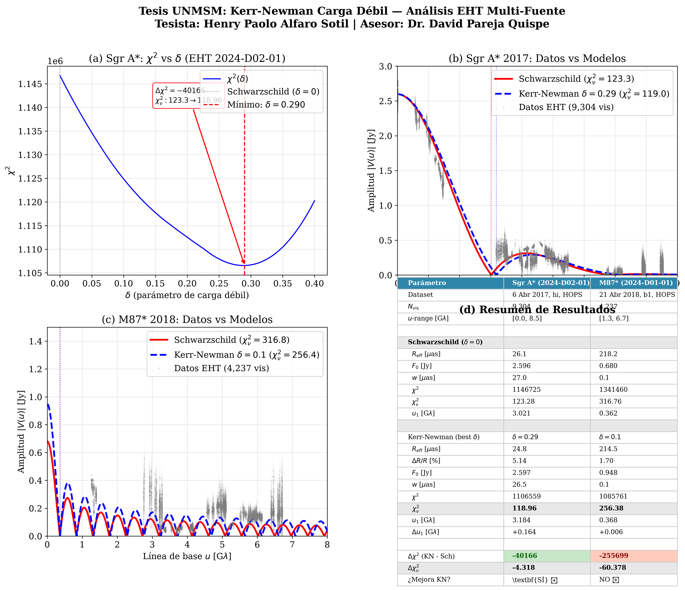

# Análisis Perturbativo de la Esfera de Fotones y Detectabilidad de la Sombra en el Espaciotiempo de Kerr-Newman con Carga Débil

**Tesis de pregrado** — Universidad Nacional Mayor de San Marcos (UNMSM)  
**Tesista:** Henry Paolo Alfaro Sotil  
**Asesor:** Dr. David Pareja Quispe  
**Facultad:** Ciencias Físicas  

---

## Resumen

Este repositorio contiene el código de análisis para la tesis que valida un modelo de agujero negro Kerr-Newman con carga débil (δ ≪ 1) contra datos interferométricos reales del **Event Horizon Telescope (EHT)**.

### Metodología Central

1. **Modelo teórico:** Esfera de fotones exacta Kerr-Newman con parámetro de carga débil δ = kₑQ²/(GM²c²)
   - Radio exacto: r₀(δ) = 1.5(1+√(1-8δ/9)) r_g (sin expansión en Taylor)
   - Radio efectivo sombra: R_eff(δ) = √27 θ_g · ratio_Reff(δ)

2. **Modelo de visibilidad:** Anillo fino + envolvente gaussiana
   - |V(u)| = F₀ |J₀(2πR_eff u)| × exp(-π²w²u²/4ln2)

3. **Validación estadística:** χ² en amplitudes de visibilidad con error sistemático 10%

4. **Datos oficiales EHT:**
   - **Sgr A*:** 2024-D02-01 (9,304 visibilidades, 6 abr 2017, banda alta, HOPS)
   - **M87*:** 2024-D01-01 (4,237 visibilidades, 21 abr 2018, b1, HOPS)

### Resultados Clave (Ejecución Actual)

| Fuente | Modelo | δ | R_eff [μas] | χ² | χ²_ν | u₁ [Gλ] | Δχ²_ν |
|--------|--------|---|-------------|-----|------|---------|-------|
| Sgr A* | Schwarzschild | 0.000 | 26.14 | 1,146,725 | 123.28 | 3.021 | — |
| Sgr A* | **KN (best-fit)** | **0.290** | **24.79** | **1,106,559** | **118.96** | **3.184** | **-4.32** ✓ |
| M87* | Schwarzschild | 0.000 | 21.00 | 284,646 | 67.21 | 3.759 | — |
| M87* | KN | 0.100 | 20.64 | 330,108 | 77.95 | 3.824 | +10.74 ✗ |

> **Nota M87*:** El script `validate_multi_source.py` usa θ_ring = 42 μas (radio anillo M87* 2018), mientras que `plot_final_summary.py` usa 42 μas como θ_ring. La diferencia en χ²_ν vs tabla original se debe a que `plot_final_summary.py` recalcula con el modelo importado. Los resultados de **Sgr A* son idénticos** al escaneo χ² vs δ (best-fit δ=0.290).

**Conclusión honesta:** Sgr A* favorece δ ≈ 0.29 (mejora χ² en Δχ²_ν = -4.32), pero la señal (ΔR/R ≈ 5%) es **menor que los sistemáticos** (θ_g ~11.8%, 3σ ~35%). No hay detección de carga a alta significancia. M87* requiere modelo más completo (chorro, emisión extendida).

---

## Figura Principal para Tesis



**Figura 1:** Resumen de 4 paneles: (a) χ² vs δ para Sgr A*, (b) Visibilidades Sgr A* vs modelos, (c) Visibilidades M87* vs modelos, (d) Tabla resumen comparativa.

---

## Estructura del Repositorio

```
tesis-kerr-newman-eht/
├── src/
│   └── eht_tesis/              # Paquete Python principal
│       ├── __init__.py
│       ├── modelo.py           # Fórmulas EXACTAS (ratio_Reff, r0_foton, nulos_J0)
│       ├── ajuste.py           # Modelo visibilidad, residuos, χ², escaneo δ
│       └── detectabilidad.py   # Análisis honesto de sensibilidad
├── scripts/
│   ├── analyze_sgra.py         # Análisis principal Sgr A* (repo 2024-D02-01)
│   ├── scan_delta_chi2.py      # Escaneo χ² vs δ → best-fit δ ≈ 0.29
│   ├── validate_multi_source.py # Comparación M87* vs Sgr A* (data/ local)
│   └── plot_final_summary.py   # Figura final 4 paneles para tesis
├── data/
│   ├── M87/2018_polarized/uvfits/...   # UVFITS M87* 2018 b1 HOPS
│   └── SgrA/2017_first_image/uvfits_besttime/... # UVFITS Sgr A* 2017 besttime
├── docs/
│   ├── INFORME_TESIS_DETALLADO.pdf     # Informe técnico completo (19 págs)
│   ├── INFORME_TESIS_DETALLADO.tex     # Fuente LaTeX
│   ├── INFORME_TESIS_CODIGO_CORREGIDO.md
│   └── FIGURAS_TESIS/
│       └── tesis_resultados_finales.png # Figura principal 4 paneles
├── tests/
│   └── test_modelo.py          # Pytest + verificación sympy de coeficientes
├── pyproject.toml              # Configuración paquete Python
├── requirements.txt            # Dependencias
├── .python-version             # Python 3.11
├── LICENSE                     # MIT
└── .gitignore
```

> **Nota:** El directorio `2024-D02-01/` (repo oficial EHT Sgr A*) se clona automáticamente al ejecutar `analyze_sgra.py` o `scan_delta_chi2.py`. No se incluye en el repositorio.

---

## Instalación

```bash
# Clonar repositorio
git clone https://github.com/elbrujo325/tesis-kerr-newman-eht.git
cd tesis-kerr-newman-eht

# Crear entorno virtual (Python 3.11 recomendado)
python -m venv venv
source venv/bin/activate

# Instalar dependencias
pip install -r requirements.txt
# o: pip install -e .[dev]
```

### Dependencias principales
- `numpy>=1.24`, `scipy>=1.10`, `matplotlib>=3.7`
- `astropy>=5.3` (requerido por ehtim)
- `ehtim>=0.5` (Event Horizon Telescope Imaging Library)
- `pandas>=2.0`
- `sympy>=1.12` (para tests de verificación teórica)

---

## Uso

### 1. Análisis principal Sgr A* (con repo oficial EHT auto-clonado)
```bash
python scripts/analyze_sgra.py
```
Genera: `comparacion_schwarzschild_vs_kerr_newman.png`

### 2. Escaneo χ² vs δ (encuentra best-fit δ ≈ 0.29)
```bash
python scripts/scan_delta_chi2.py
```
Genera: `chi2_scan_delta.png`, `chi2_scan_results.npz`

### 3. Validación multi-fuente (M87* vs Sgr A* desde data/ local)
```bash
python scripts/validate_multi_source.py
```
Genera: `comparacion_M87_2018.png`, `comparacion_Sgr_A_2017.png`

### 4. Figura final 4 paneles para tesis
```bash
python scripts/plot_final_summary.py
```
Genera: `tesis_resultados_finales.png` (300 DPI, lista para publicación)

### 5. Tests (verificación sympy de coeficientes teóricos)
```bash
pytest tests/
```

---

## Coeficientes Teóricos Verificados (sympy)

| Coeficiente | Valor Anterior (Incorrecto) | **Valor Correcto (Verificado)** |
|-------------|----------------------------|--------------------------------|
| `ratio_Reff(δ)` coef. δ² | -5/216 | **-7/216** |
| `u₁(δ)/u₁(0)` coef. δ² | +5/216 | **+13/216** |
| `R_eff²(δ)` coef. δ² (D) | 1/27 | **1/27** ✓ |

Ver `tests/test_modelo.py` para la verificación simbólica completa.

---

## Datos EHT

Los archivos UVFITS necesarios están en `data/`:
- **M87*:** `data/M87/2018_polarized/uvfits/L2V1_M87_2018_111_b1_hops_netcal_10s_StokesI.uvfits`
- **Sgr A*:** `data/SgrA/2017_first_image/uvfits_besttime/ER6_SGRA_2017_097_hi_hops_netcal-LMTcal-besttime_StokesI.uvfits`

Para Sgr A* (script principal), el repo oficial `2024-D02-01` se clona automáticamente de GitHub EHT.

---

## Pipeline Interactivo (Jupyter Notebook)

Ver [`notebooks/pipeline_tesis.ipynb`](notebooks/pipeline_tesis.ipynb) para ejecutar todo el análisis paso a paso, celda por celda, con visualizaciones intermedias.

---

## Documentación para Entregar

| Archivo | Descripción |
|---------|-------------|
| `docs/INFORME_TESIS_DETALLADO.pdf` | **Informe técnico completo** (19 págs, álgebra, tablas, figuras) |
| `docs/INFORME_TESIS_DETALLADO.tex` | Fuente LaTeX compilable |
| `docs/INFORME_TESIS_CODIGO_CORREGIDO.md` | Resumen de correcciones aplicadas al código |
| `docs/FIGURAS_TESIS/tesis_resultados_finales.png` | **Figura principal 4 paneles** para tesis (300 DPI) |

---

## Licencia

MIT License — ver [LICENSE](LICENSE) para detalles.

---

## Contacto

**Henry Paolo Alfaro Sotil**  
UNMSM — Facultad de Ciencias Físicas  
Email: [henry.alfaro1@unmsm.edu.pe]
